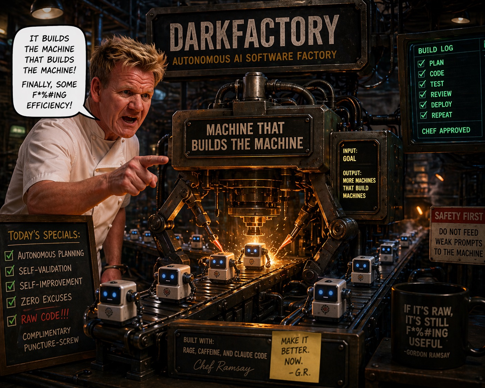
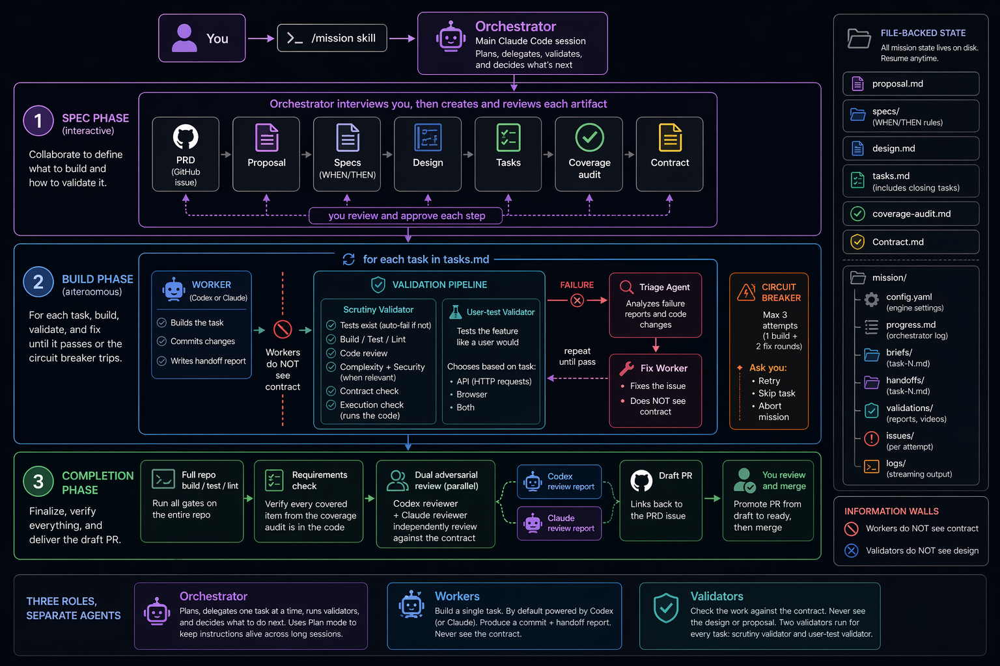

# Darkfactory



Darkfactory lets you describe what you want to build, and then multiple AI agents plan the work, write the code, check each other's work, and deliver a draft pull request. It runs inside [Claude Code](https://docs.anthropic.com/en/docs/claude-code).

No custom IDE or framework required. Darkfactory is built from Claude Code's own features:
- **Skills** -- reusable prompt templates you invoke with slash commands (e.g. `/mission`)
- **Subagents** -- separate AI workers that each get their own conversation
- **Plan mode** -- persistent instructions that survive long sessions
- **Markdown files** -- all state lives on disk, not in memory

Inspired by [Factory's Missions architecture](https://www.factory.ai/) and [Matt Pocock's AI development skills](https://github.com/mattpocock/skills).

## Setup

### Prerequisites

- [Claude Code](https://docs.anthropic.com/en/docs/claude-code) installed and authenticated
- [OpenSpec CLI](https://github.com/Fission-AI/OpenSpec) installed (`npm install -g @fission-ai/openspec`)
- [Codex CLI](https://github.com/openai/codex) installed (`npm install -g @openai/codex`) and authenticated (`codex login`)
- [GitHub CLI](https://cli.github.com/) installed and authenticated (`gh auth login`) -- used for filing the PRD as a GitHub issue and creating draft PRs
- [jq](https://jqlang.github.io/jq/) installed (`brew install jq`) -- used for parsing dispatch results
- [Rust toolchain](https://rustup.rs/) installed (`curl --proto '=https' --tlsv1.2 -sSf https://sh.rustup.rs | sh`) -- needed to build darkfactory-dispatch
- A git repository to work in

### First-time install

Clone Darkfactory and symlink its skills into your global Claude Code skills directory:

```bash
git clone https://github.com/layercodedev/darkfactory.git ~/.darkfactory
cd ~/.darkfactory
./install.sh
```

Then build and install the dispatch supervisor:

```bash
cd ~/.darkfactory/tools/darkfactory-dispatch && make install
```

This compiles a Rust binary and copies it to `~/.local/bin/darkfactory-dispatch`. It supervises Codex subprocess dispatches with process group isolation, two-phase timeout, NDJSON heartbeat events, and structured JSON results.

Symlinks mean the skills always point to your local clone, so updating is just a `git pull` (see below).

Restart Claude Code, then from any project run:

```
/mission-init
```

This checks your entire setup and tells you exactly what's missing. It verifies all 12 skills are symlinked, CLI tools (codex, gh, openspec, darkfactory-dispatch, jq), coverage tools for your project's language (cargo-tarpaulin for Rust, jest/c8 for TypeScript, pytest-cov for Python), and initializes OpenSpec in the current project if needed.

### Updating

Since skills are symlinked to your clone, pulling updates everything:

```bash
cd ~/.darkfactory && git pull
```

## What it does

A mission is the core unit of work. It takes you from a goal ("build user authentication") to a validated draft PR, through three stages.

### Stage 1: You and the orchestrator plan together

The orchestrator is the main Claude Code session that runs your mission. It starts by interviewing you about what you want to build, asking pointed questions until it understands your goals, constraints, and edge cases. It then creates a shared glossary of terms so that you, the orchestrator, and all workers use the same vocabulary.

From that conversation, it writes a PRD (Product Requirements Document) -- a structured description of the problem, the solution, user stories, and testing approach. The PRD is filed as a GitHub issue and becomes the source of truth for everything that follows. At the end of the mission, the draft PR links back to this issue.

Next, it creates a series of planning documents using [OpenSpec](https://github.com/Fission-AI/OpenSpec) (an open-source tool for structured change proposals). These documents are created one at a time, and you review each before the orchestrator moves on:

- **Proposal** -- what you're building and why
- **Specs** -- detailed requirements written as WHEN/THEN rules (e.g. "WHEN a user submits the login form with wrong credentials, THEN show an error message")
- **Design** -- architecture decisions and technical approach. The design evaluates 2-3 architecture candidates against a four-dimension rubric (separation of concerns, testability, task independence, module depth) and picks the highest-scoring option. A mandatory gate verifies the design includes an architecture decision, module inventory, type catalog, error strategy, integration points, and test strategy; the Type Catalog names problem-space domain types and excludes technical helpers like CLI parsers, test fixtures, and generic containers.
- **Tasks** -- an ordered checklist of implementation work. Before generating tasks, the orchestrator presents a decomposition strategy (layered, vertical, or hybrid) with a target task count for your approval. Each task includes topology metadata -- which prior tasks it depends on, what it consumes, and what it produces.

Every tasks.md ends with a set of **mandatory closing tasks** that run after the feature work: a smoke test (one end-to-end test through the primary user flow against real dependencies), a cleanup task (remove dead code, unused deps, and leftover scaffolding), a module shape re-check (catch drift between design.md and what the code actually exposes, including Type Catalog domain type names -- required once a mission has 5+ feature tasks), a documentation task, and a CLAUDE.md + ARCH.md generation task (creates project convention files if they don't already exist). A CI configuration task is optional and added when relevant.

After the tasks are defined, the orchestrator runs a **coverage audit**. This maps every requirement from the PRD to one or more tasks. If anything is missing, it flags it. If a requirement was intentionally changed or dropped, you approve that decision explicitly. For substitutions, the orchestrator also checks that the replacement approach is fully covered by existing tasks -- if the substitution drops something important, it's flagged as a gap. Nothing falls through the cracks by accident.

Contract checks trace back to specific spec capability and scenario identifiers for end-to-end traceability.

Finally, it writes a **contract** -- a checklist of things the finished code should do, written so they can be tested from the outside (by running the code, not by reading the source). For example: "the login endpoint returns a 401 when given wrong credentials." Each item traces back to a specific spec scenario and is tagged with how it should be verified (by executing the code, checking its output, or inspecting the source). Before moving on, the orchestrator runs a testability check to catch any vague or untestable items early. You review the contract, confirm which AI models handle each role (see [Configuration](#configuration)), and approve launch.

### Stage 2: The orchestrator builds and validates autonomously

For each task, the orchestrator sends a worker (Codex or Claude, your choice) a brief describing what to build. The worker writes the code, commits its changes, and writes a handoff report. Workers never see the contract -- this is intentional, and explained in [information walls](#information-walls) below.

After the first task passes validation, the orchestrator runs a foundation audit -- checking that the committed code's module structure and type names match the design. This catches naming drift before it cascades into subsequent tasks.

After each worker finishes, two validators check the work:

1. **Scrutiny validator** -- a thorough quality review that runs a sequence of gates:
   - Do tests exist? (auto-fails the task if not)
   - Does the project build, do the tests pass, does the linter pass?
   - Code review and code standards gate
   - Module depth review -- did the change make modules shallower or leak internal details?
   - Complexity gate -- is the code more complex than it needs to be?
   - Security review (only when the changes touch auth, secrets, user input, network boundaries, or filesystem trust boundaries)
   - Contract checks gate -- does the code do what the contract says it should?
   - Behavioral conformance gate -- actually runs the code to confirm it works, rather than just reading the source
   - Test health gates -- silent skip detection, diff coverage on changed lines, and test quality review

2. **User-test validator** -- tests the feature the way a user would. It decides whether to hit an API with HTTP requests, drive a browser, or both, based on what the task changed.

If either validator finds problems, the orchestrator sends a fix worker a description of what went wrong. It only describes the symptoms -- it never reveals the contract, so the fix worker has to solve the real problem, not just game the checklist. After the fix, both validators re-run from scratch.

This loop repeats until the task passes or hits the **circuit breaker**. After 3 total attempts (1 initial build + 2 fix rounds), the orchestrator pauses and asks you: retry, skip this task, or abort the mission.

### Stage 3: You review and merge

After all tasks are complete, the orchestrator runs three final checks:

1. **Full-repo build check** -- builds, tests, lints, and formats the entire repository (not just the changed files). This catches cases where a late task accidentally broke something an earlier task built.
2. **Requirements check** -- compares the built code against the coverage audit. Did you actually build everything you said you would? If something is missing, you decide whether to add a fix task, reclassify it as intentionally skipped, or accept the gap.
3. **Independent code review** -- two separate reviewers (Codex and Claude, running at the same time) each review all the changes against the full contract. Their reports are presented to you alongside the draft PR link. This is not an automated gate -- you read both reports and decide what to address.

You review the findings, promote the PR from draft to ready, and merge.

## Architecture



### Three roles

The system has three roles, each handled by a separate AI agent:

**Orchestrator** -- the main Claude Code session you interact with. It plans the work, sends out one worker at a time, reads their results, runs validators, and decides what to do next. It uses Claude Code's "plan mode," which keeps its instructions alive even when the conversation gets long enough that older messages are dropped to save space.

**Workers** -- each worker builds a single task. By default, workers are powered by Codex (OpenAI's coding agent), but you can use Claude instead. Codex workers are dispatched through `darkfactory-dispatch`, a Rust process supervisor that provides process group isolation, two-phase timeout (SIGTERM then SIGKILL), heartbeat events every 15 seconds, and structured JSON results. Claude workers use Claude Code's built-in Agent tool. A worker gets a brief with everything it needs: what to build, how the project is structured, coding rules to follow, which exact Type Catalog domain type names to use, which files to look at, and a summary of what previous tasks already built (file paths, function names, and types -- facts only, never reasoning from other workers). It makes its changes in a single commit and writes a report describing what it did. Workers never see the contract -- they only know what the brief tells them.

**Validators** -- after each worker finishes, validators check the work against the contract. Two validators run back-to-back for every task: the scrutiny validator (a thorough quality check) and the user-test validator (which tests the feature the way a real user would). Validators never see the proposal or design documents -- they only see the code and the contract.

### Information walls

Workers never see the contract. Validators never see the design. Why?

If a validator could see the design intent, it might look at the code and think "this looks like what the design described" without actually checking whether the code works. By keeping workers and validators blind to each other's information, the system forces validation to be based on what the code *does*, not what someone *intended* it to do.

The same principle applies when fixing problems. When a validator finds something wrong, the orchestrator tells the fix worker what the symptoms are -- but never reveals the contract. The fix worker has to solve the real problem, not just make a checklist item pass.

### Fix loop

When either validator fails a task, a diagnostic triage agent first reads the failure report and the code changes to pinpoint the likely root cause (which file, which line, what went wrong). The orchestrator then sends a fix worker the symptoms and triage findings -- but never the contract, so the information wall is maintained. After the fix, both validators re-run from scratch. If it fails again, another fix round runs.

The **circuit breaker** stops this from going forever. After 3 total attempts (the first build plus 2 fix rounds), the orchestrator pauses and asks you: retry (the counter keeps going -- it doesn't reset), skip this task, or abort the mission.

### File-backed state

All mission state lives in files on disk, not in memory. This has two practical benefits: if your Claude Code session crashes or you close the terminal, you can resume the mission from where it left off. And you can open a second terminal to check progress while a mission is running.

```
openspec/changes/<change-name>/
  proposal.md              # What and why
  specs/<capability>/spec.md  # Formal WHEN/THEN requirements (one per capability)
  design.md                # How (architecture decisions)
  tasks.md                 # Task checklist (includes mandatory closing tasks)
  coverage-audit.md        # PRD requirement-to-task mapping
  contract.md              # What the code should do (traced to PRD, tagged by verification method)
  mission/
    config.yaml            # Engine settings per role
    progress.md            # Orchestrator's running log
    briefs/task-N.md       # Worker briefs
    handoffs/task-N.md     # Worker handoff reports
    validations/           # Validator reports, demo videos
    issues/                # Failure details per attempt
    logs/                  # Streaming output from workers and reviewers (tail -f to watch live)
```

## Skills

Darkfactory is controlled through skills -- reusable prompt templates you invoke with a slash command in Claude Code.

| Skill | Purpose |
|-------|---------|
| `/mission` | Start an autonomous mission from scratch. Walks you through planning, dispatches workers, validates, and delivers a draft PR. |
| `/mission-resume` | Resume a mission that was interrupted (session crash, closed terminal). Detects exactly where it left off and continues through to the draft PR and code review. |
| `/mission-status` | Read-only progress check. Open a second terminal while a mission runs to see which tasks are done, in progress, or queued. |
| `/mission-init` | Check your project setup. Verifies all 12 skill symlinks, CLI tools, and coverage tools. Runs `openspec init` if needed. |
| `/grill` | Alignment interview: asks pointed questions until the goals, constraints, and edge cases are clear. Used in the mission planning phase. |
| `/prd` | Turns an interview into a structured PRD filed as a GitHub issue. Used in the mission planning phase. |
| `/language` | Creates a shared glossary (ubiquitous language) so you, the orchestrator, and all workers use the same terms. Used in the mission planning phase. |
| `/tdd` | Test-driven development guidance. Workers invoke this during the build phase for backend, hooks, and utility tasks. Companion files cover deep modules, interfaces, mocking, refactoring, and test patterns. |
| `/frontend` | Prescriptive builder guide for React/TypeScript component development. Workers invoke this during the build phase for frontend component, page, and layout tasks. Defines the design-implement-test workflow with visual verification via chrome-devtools-mcp. Companion files: DEEP-COMPONENTS.md (four rules), STACK.md (tech stack), PATTERNS.md (code examples), TESTING.md (behavioral testing). |
| `/ui-system` | ShadCN/Radix component selection, token discipline, composition patterns, and accessibility defaults. Constraint skill used alongside `/frontend`. Verbatim upstream content from shadcn/ui. |
| `/react-perf` | React and Next.js performance optimization from Vercel Engineering. Waterfall elimination, bundle size, re-render discipline, server-side patterns. Constraint skill used alongside `/frontend`. Verbatim upstream content from Vercel. |
| `/test-quality` | LLM-based semantic review of test effectiveness. The scrutiny validator runs this as a subagent after every worker commit. |
| `/security` | Security review. The scrutiny validator runs this when the diff touches auth, secrets, user input, or network/filesystem boundaries. |
| `/adversarial` | Dual-agent code review: dispatches a Codex reviewer and a Claude reviewer with identical input, then surfaces disagreements. |
| `/dispatch` | Run a coding task via `darkfactory-dispatch`. Accepts a task description inline or prompts for one. Presents structured outcome. |
| `/arch-review` | Architecture review with guides for deepening modules, interface design, and language precision. Standalone -- not yet wired into missions. |
| `/domain-model` | Domain modeling with ADR and bounded context formats. Standalone -- not yet wired into missions. |
| `/module-design` | Module design and boundary analysis. Standalone -- not yet wired into missions. |
| `/qa` | QA review skill. Standalone -- not yet wired into missions. |
| `/write-a-skill` | Meta-skill for writing new Darkfactory skills. Standalone -- not yet wired into missions. |

### Skill structure

`/mission` is split across files so only the control flow is always in context:

- `SKILL.md` -- control flow, rules, phase gates (auto-loaded)
- `templates/` -- artifacts the orchestrator fills in: `plan.md`, `coverage-audit.md`, `contract.md`, `worker-brief.md`, `worker-fix-brief.md`, `pr-body.md`, `design-template.md`, `claude-md.md`
- `prompts/` -- prompts handed to subagents: `scrutiny-validator.md`, `usertest-validator.md`, `spec-delta-checker.md`, `adversarial-reviewer.md`

Companion files are read on demand when the skill reaches the step that needs them.

### Other skills used by `/mission`

All Darkfactory skills are bundled in this repo. `/mission` also calls two built-in Claude Code skills and accepts two optional project-specific skills:

| Skill | Source | When it's used |
|-------|--------|---------|
| `/review` | Built-in Claude Code (required) | Scrutiny validator: code review step |
| `/simplify` | Built-in Claude Code (required) | Scrutiny validator: complexity check step |
| `/test-app` | Your project's Claude skills (optional) | User-test validator: browser-based testing |
| `/demo-video` | Your project's Claude skills (optional) | Records a demo of frontend changes after validation passes |
| `openspec` CLI | Installed by `npm install -g @fission-ai/openspec` | Planning phase: creates the structured artifacts (proposal, specs, design, tasks) |
| `/opsx:archive` | Bundled with Darkfactory | Post-merge: moves the change's planning files into the OpenSpec archive directory |

`/review` and `/simplify` are mandatory -- the scrutiny validator always runs them. `/test-app` and `/demo-video` are optional and project-specific -- you write these yourself for your project if you want browser testing or demo recordings.

### Configuration

Darkfactory reads global defaults from `~/.darkfactory/config.yaml`:

```yaml
default_model: gpt-5.5
```

The `/dispatch` and `/adversarial` skills use `default_model` for Codex dispatches. If the file or key is missing, they fall back to `gpt-5.5`.

Each mission creates a `config.yaml` that controls which AI engine handles each role. You can change these before approving the plan:

```yaml
engines:
  worker: codex                    # or claude
  scrutiny_validator: claude
  usertest_validator: claude
  adversarial_reviewer_a: codex
  adversarial_reviewer_b: claude
  demo_video: claude
```

The default uses Codex for workers and one of the two independent code reviewers, and Claude for everything else. You can set any role to either engine.

## Usage

### Start a mission

```
/mission Build a user authentication system with email/password login, session management, and a profile page
```

The orchestrator walks you through the planning phase interactively -- interviewing you, creating documents, and asking for your approval at each step. Once you approve the plan and confirm launch, it runs the build loop autonomously. You don't need to do anything until it finishes or hits the circuit breaker.

### Check progress

From another terminal while a mission runs:

```
/mission-status
```

This shows a progress bar, the status of each task (queued, in progress, done), validation results, and fix attempt counts.

### Resume after interruption

If your session crashes or you close the terminal:

```
/mission-resume
```

This is a separate skill, not a flag on `/mission`. It reads the files on disk, figures out exactly where the mission was interrupted -- including tasks where the code was committed but validation never ran -- and continues from that point. Once all tasks are done, it creates a draft PR and runs the independent code review.

### When it's done

The orchestrator creates a draft PR and presents you with two independent code review reports. Review the findings, promote the PR from draft to ready, and merge. Then archive the change -- this moves the planning files (proposal, specs, design, contract, etc.) into the OpenSpec archive so they're preserved but out of the way:

```
/opsx:archive
```

## When to use a mission

The workflow scales naturally to match the size of the work. A small bug fix produces a short interview, one task, and full validation. A large feature produces a long interview, many tasks, and the same validation per task. The process is the same regardless of scope.

| Scope | What happens |
|-------|-------------|
| Quick bug fix | Short interview, 1 task, full validation, draft PR |
| Small feature | Medium interview, 1-2 tasks, full validation, draft PR |
| Multi-task feature | Long interview, many tasks, full validation per task, draft PR |
| Large refactor | Long interview (40+ questions), many tasks, full validation, draft PR |
| Overnight build | Same as above, run in tmux |

## How it was built

The first version was hand-written during a `/grill` session that produced the design decisions and shared vocabulary. The second version was built by Darkfactory itself -- Claude workers generated the skills from the specs, and a Codex code review caught issues that a fix worker addressed. Everything since then has been iterative improvement, and the system is still actively evolving.

## Key references

- [Architecture](ARCH.md) -- living architecture document covering the three-role agent model, information walls, build loop, and planning constraints
- [Factory Missions talk](docs/reference_factory_talk.md) -- the multi-agent architecture that inspired this project
- [Matt Pocock skills talk](docs/reference_pocock_talk.md) -- design alignment, ubiquitous language, and TDD patterns
- [Provenance](docs/provenance.md) -- how Darkfactory relates to both sources: what's faithful, what's different, and what's new
- [Design decisions](docs/design-decisions.md) -- every architectural choice with rationale
- [Ubiquitous language](UBIQUITOUS_LANGUAGE.md) -- shared terminology used throughout the codebase

## License

MIT
